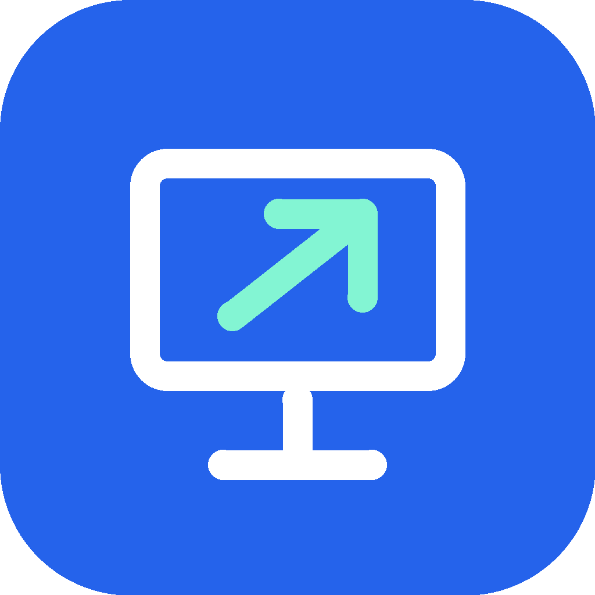

# SeekTop · 寻桌

**NodeSeek 非官方 Windows 桌面客户端**，基于 [Nodyssey](https://github.com/5151561/nodyssey) 二次开发与桌面移植，采用 GPL-3.0，保留上游版权与贡献归属。

[下载 Windows x64 便携版](https://github.com/ccwan-mamoon/seektop/releases/download/desktop-v1.0.4/SeekTop-1.0.4-windows-x64.zip) · [更新记录](CHANGELOG.md) · [问题反馈](https://github.com/ccwan-mamoon/seektop/issues)· [交流群组](https://t.me/SeekTopHub)

开发版 1.0.12：回复、发帖下方新增本地剩余价值计算器，结果一键插入带图标的 Markdown 表格。AI 设置中可查看、手动修改保存汇率，手动值优先且不被自动更新覆盖。启动后台缓存 15 种常用币种参考汇率，分析时自动提供汇率、日期与来源。只分析楼主包含后续楼主回复，默认通用及交易提示词精简并可在设置中直接编辑。首次提示是否接管外部链接，AI 支持追问补充及楼主／全楼层范围选择。设置中可选启用原生外部链接接管，自动记住原浏览器；完成 Windows 默认关联后，Telegram 等外部应用的 NodeSeek 帖子直接打开 SeekTop。帖子点击「AI 分析」即可查看 Markdown 结果，API 和各板块提示词统一在设置页配置，无需安装 AI 插件。当前公开稳定下载仍为 1.0.4。

## 下载与启动

当前版本为 **1.0.4**。首次使用可下载 [EXE 安装包](https://github.com/ccwan-mamoon/seektop/releases/download/desktop-v1.0.4/SeekTop-1.0.4-windows-x64-setup.exe)，也可选择 ZIP 便携包，完整解压后打开 **SeekTop.exe** 并保留整个目录。两者均无需另外安装 Java、Node.js 或 Python。

本版已支持一键升级：有更高版本时，在应用内下载、校验后点击重启，自动退出替换并重新打开。登录资料和设置保留，旧版目录留作备份。不含更新代码的旧版本需要先切换到 0.4.0。

1.0.4 已优化更新下载：支持代理、断点续传、取消后继续，以及速度和剩余时间显示。下载完成后点击重启，避免重复确认。

## 为桌面重新设计

- **桌面导航**：可折叠图标菜单；常用板块按需添加，设置跨重启保存。
- **分栏阅读**：默认显示菜单和帖子列表，打开帖子后展示详情；重复点击同篇或点击关闭按钮收起详情，分隔线支持拖拽调宽。
- **整合搜索**：顶栏切换帖子／用户搜索并选择板块，结果直接进入内容区。
- **阅读控制**：列表和详情独立滚动、鼠标拖拽滚动、右下角图标刷新，以及可输入目标页的分页；刷新回到第 1 页顶部。
- **原生登录**：账号密码与两步验证表单，应用内加载官方人机验证，共享 Chromium 会话。
- **桌面通知**：互动、私信、关键词与追踪回复分别设置检查间隔，支持免打扰、去重和网络异常退避。
- **主题与标识**：预设／自定义强调色、浅色／深色／跟随系统，应用和 EXE 使用统一图标。
- **桌面工作区**：我的、收藏、历史、关注、通知及设置使用桌面布局；宽窗口编辑与预览并排。

| 快捷键 | 操作 |
| --- | --- |
| Ctrl+K | 搜索 |
| Ctrl+N | 发帖 |
| Alt+← | 返回 |
| Ctrl+, | 设置 |

## 通知与升级

互动和私信可选 **30 秒、1、2、5 分钟**；关键词与追踪回复可选 **1、2、5、10、15 分钟**，各自保留开关。通知检查在运行或最小化期间执行，完全退出后停止；Windows 勿扰设置可能隐藏弹窗。互动和私信需要登录，通知采用定时检查。

一键升级仅接收本仓库的 Windows x64 包，并校验 GitHub SHA-256、包结构和版本号；默认不接收预览版。替换或启动进程失败时恢复旧目录；若新进程仍运行却未确认启动，则保留备份并报告状态。应用目录及父目录需可写，其他实例占用文件时不会被强制结束。

数据保存在 `%LOCALAPPDATA%/SeekTop`，升级不会替换这个目录。请勿上传 Cookie、密码、令牌或个人数据库。

## 验证范围

JVM 回归覆盖导航与刷新、分页、搜索状态、通知独立计时、偏好持久化、升级确认、版本筛选、下载完整性及路径安全。独立更新程序已使用完整程序副本完成退出、替换、自动重启、启动确认与资料保留演练，并测试失败回滚。

官方页面的真实人机验证曾在独立临时会话中验证。真实账号登录及发帖、回复、点赞、签到、转账等写入操作仍需按实际账号验收。完全退出后的后台通知／离线任务尚不支持，Android 与 Apple 平台未在本次桌面发布中验证。

## 开发中的插件中心

1.0.5 开发版已接入官方网络工具插件中心：网速测试、连通性测试与 iperf3 独立下载安装，支持启停、卸载和独立更新。每个插件约 4.6 MB，引擎不捆绑进主体。当前正式版 1.0.4 尚不支持插件。

工具页面使用客户端原生 Compose 界面；首批仅接受 SeekTop 官方签名的原生工具，安装时说明其 Windows 用户权限。第三方 JS、邮箱和图床插件仍在预留阶段。详见[插件说明](docs/plugin-extension-points.md)。

## 从源码构建

准备 JDK 21、Python 3.11+ 和 Windows 自带的 .NET Framework 编译器，使用仓库 Gradle wrapper：

```powershell
python desktop/provision-browser.py
./gradlew :desktop:jvmTest :shared:jvmTest :ui:jvmTest :designsys:jvmTest :richtext:jvmTest spotlessCheck
python desktop/tests/test_browser.py
python desktop/tests/test_updater.py
./gradlew :desktop:createDistributable
./gradlew --stop
```

输出目录为 `desktop/build/compose/binaries/main/app/SeekTop`。浏览器运行时下载较慢时，可给准备脚本增加 `--mirror https://npmmirror.com/mirrors/electron`。

桌面版本号统一位于 `gradle/libs.versions.toml` 的 `versions.seektop`；Windows 发布工作流手动触发，自动生成同版本程序包、对应源码与 SHA-256。详见[客户端开发与命名说明](docs/client-development.md)、[桌面开发说明](desktop/README.md)及[文档导航](docs/README.md)。

## 来源与许可

上游为 [5151561/nodyssey](https://github.com/5151561/nodyssey)，代码基线 `495997983257a83d47a3c01ffbbe4fbe7205db14`。本项目复用其富文本、内容解析、共享业务逻辑及其他实现，在此基础上增加 Windows 壳并重构桌面交互；并非独立重写，与 NodeSeek 官方及上游维护者无隶属或背书关系。

项目使用 [GNU GPL v3.0](LICENSE)。源码包名、入口类与构建工程统一为 SeekTop；Android、iOS 平台代码保留，版权及上游历史文档原文保留。分发修改版时须保留许可与归属，并提供对应源码和构建脚本。

来源与第三方组件详见 [NOTICE.md](NOTICE.md)，原始介绍和历史记录存档于 [docs/upstream](docs/upstream/)。感谢 Nodyssey 作者、贡献者及所依赖的开源项目。
